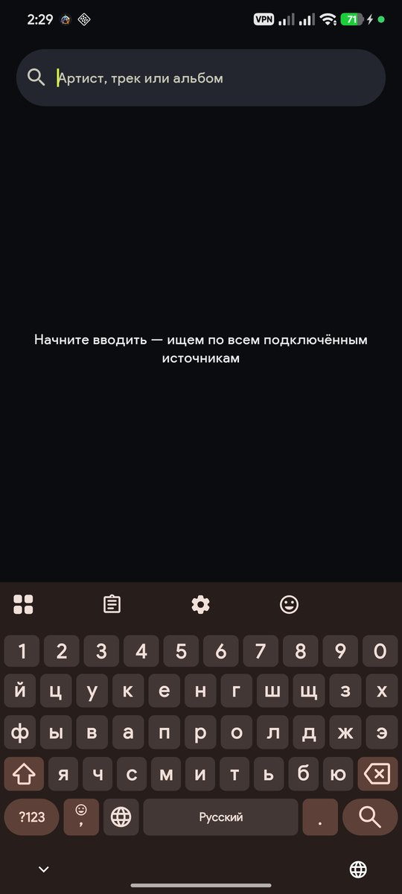

<div align="center">

<picture>
  <source media="(prefers-color-scheme: dark)" srcset="docs/hero-dark.svg">
  
</picture>

**Музыкальный плеер для Android: Яндекс Музыка, своя волна, коллекция и караоке — в одном Material 3 интерфейсе.**

<p>
  <a href="https://flutter.dev"></a>
  
  
  
  
</p>

</div>

---

## Что это

Локальный плеер, который не заставляет выбирать между сервисами: один интерфейс,
один источник музыкального каталога и один экран «сейчас играет» — независимо от
того, откуда трек пришёл.

- **Яндекс Музыка** — вход по OAuth device flow, поиск, «Моя волна» и станции
  с настройками, любимое и плейлисты, карточки артиста и альбома, чарт.
- **Коллекция** — вся музыка в одном месте: любимое (1028 треков на аккаунте
  владельца), плейлисты, локальные файлы, недавние. Фоновая синхронизация
  с Яндексом раз в сутки, реальные даты лайков.
- **Плеер** — foreground-сервис `mediaPlayback`, уведомление и экран блокировки,
  очередь, таймер сна, плавное затухание, восстановление после смерти процесса.
- **Караоке** — построчный синхронный текст, крупная активная строка, маска
  прогресса внутри неё, тап по строке — перемотка.
- **Локальные файлы** — теги и встроенные обложки читаются нативно, файлы играют
  на равных с каталогом.
- **Оформление** — Material 3 Expressive: тема, палитра (фирменная, Material You,
  монохром), шесть акцентов, контраст, скругления, скорость анимаций, RU/EN,
  шесть значков лаунчера, компактная панель.

## Скриншоты

<div align="center">

<table>
  <tr>
    <td width="33%"></td>
    <td width="33%"></td>
    <td width="33%"></td>
  </tr>
  <tr>
    <td align="center">Моя волна</td>
    <td align="center">Коллекция: 1028 треков</td>
    <td align="center">Сейчас играет</td>
  </tr>
  <tr>
    <td></td>
    <td></td>
    <td align="center"><sub>Дальше: караоке, карточка артиста,<br>меню трека, чарт</sub></td>
  </tr>
  <tr>
    <td align="center">Поиск по всем источникам</td>
    <td align="center">Настройки по разделам</td>
    <td></td>
  </tr>
</table>

</div>

## Архитектура

Каждый источник музыки — модуль за одним интерфейсом: поиск, метаданные, поток.
Если трек не играет в одном источнике, цепочка идёт к следующему по приоритету.

```
lib/
├── core/
│   ├── sources/      MusicSource, DTO, типизированные отказы, StreamResolver
│   ├── identity/     нормализация и сведение трека из разных каталогов
│   ├── db/           15 таблиц drift, DAO, упорядоченные миграции
│   ├── prefs/        настройки одним снимком
│   └── platform/     мост в Android: частота кадров, значки, теги файлов
├── features/         волна, поиск, коллекция, плеер, каталог, караоке, настройки
├── sources/          yandex, local, lyrics (LRCLIB → lyrics.ovh)
├── l10n/             строки RU/EN
└── theme/            токены M3: цвет, типографика, формы, движение
```

**Правила, которые держат код в форме:** UI не знает про `audio_service` и ходит
только через `PlaybackController`; экраны не импортируют конкретные источники;
миграции схемы только аддитивные; в интерфейсе нет выдуманных данных.

## Стек

| Слой | Чем |
|---|---|
| UI | Flutter 3.47.7, Material 3 Expressive, Riverpod 3, go_router 18 |
| Звук | just_audio 0.10.6 (media3/ExoPlayer), audio_service 0.18.19 |
| Данные | drift 2.35.2 + SQLite, 15 таблиц, миграции |
| Сеть | dio, Yandex Music API, LRCLIB |
| Локализация | `flutter gen-l10n`, русский по умолчанию |

## Сборка

```bash
flutter pub get
dart run build_runner build     # после правок схемы drift
flutter gen-l10n                # после правки lib/l10n/*.arb
flutter analyze && flutter test
flutter build apk --release
```

Только Android: `compileSdk = targetSdk = 37` (`compileSdkMinor = 0`), `minSdk = 24`.
Тесты фонового воспроизведения — на физическом устройстве: эмулятор на машине
разработчика недоступен.

## Статус

Работает: вход, поиск, волна и станции, коллекция с полной синхронизацией,
плеер с фоном и уведомлением, караоке, локальные файлы, настройки.

Дальше: офлайн-скачивание, SoundCloud и YouTube как запасные источники,
каталоги Spotify/Deezer, редактор таймингов караоке.

## Лицензия

MIT — см. [LICENSE](LICENSE). Проект не связан с Яндексом; «Яндекс Музыка» —
товарный знак соответствующего правообладателя. Тексты песен приходят из
публичных источников и отображаются по запросу пользователя.
