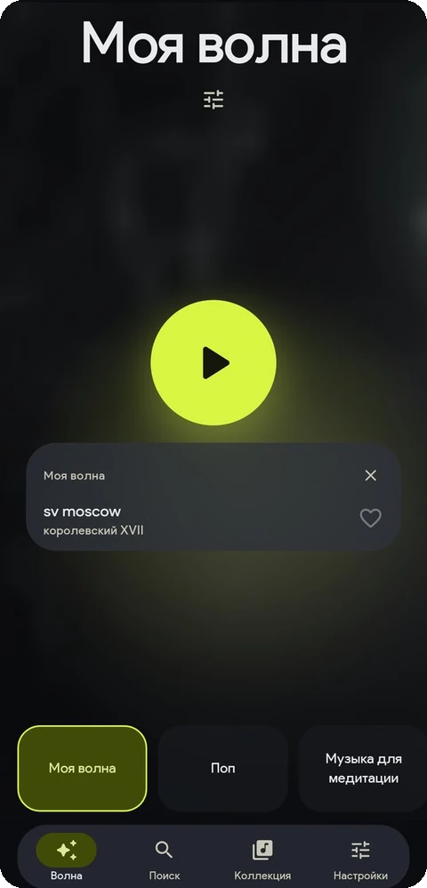
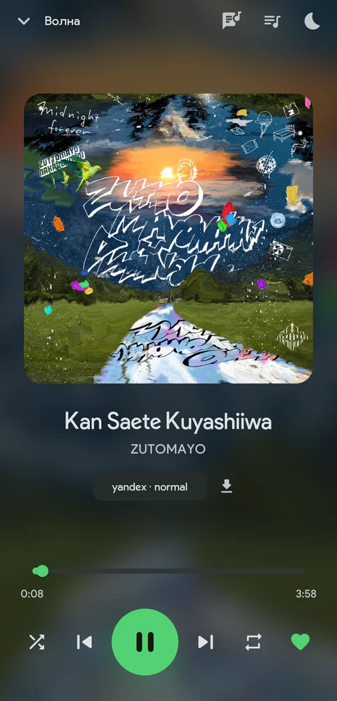
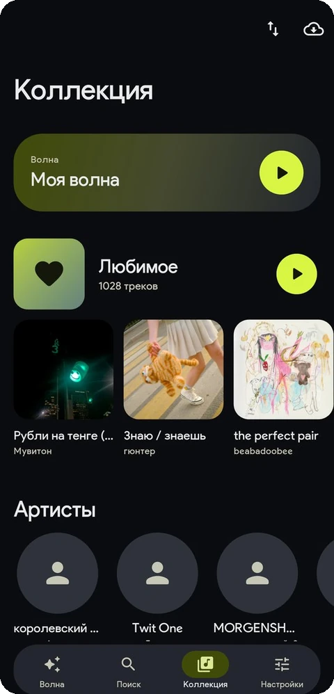
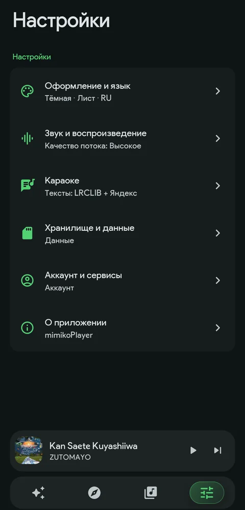
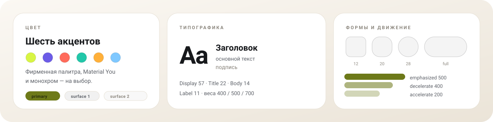

<div align="center">

<picture>
  <source media="(prefers-color-scheme: dark)" srcset="docs/hero-dark.svg">
  
</picture>

<p><a href="https://flutter.dev"></a>    </p>

**[Возможности](#возможности)** · **[Скриншоты](#скриншоты)** · **[Material 3](#material-3)** · **[Архитектура](#архитектура)** · **[Сборка](#сборка)**

</div>

## Что это

mimikoPlayer — Android-плеер, который не заставляет выбирать между сервисами. Яндекс Музыка, YouTube, локальные файлы и караоке живут в одном интерфейсе: один экран «сейчас играет», одна очередь и одна коллекция — независимо от того, откуда пришёл трек. Оформление собрано на токенах Material 3 Expressive, а на экране только настоящие данные.

## Возможности

<picture>
  <source media="(prefers-color-scheme: dark)" srcset="docs/features-dark.svg">
  
</picture>

Плеер живёт в foreground-сервисе `mediaPlayback`: музыка не останавливается при свёрнутом приложении, управление доступно в уведомлении и на экране блокировки, очередь переживает смерть процесса. «Моя волна» догружает следующую партию треков сама и не повторяет уже сыгранное.

## Скриншоты

<div align="center">

<table>
  <tr>
    <td width="50%" align="center"></td>
    <td width="50%" align="center"></td>
  </tr>
  <tr>
    <td align="center"><sub><b>Моя волна</b> — станции и текущий трек</sub></td>
    <td align="center"><sub><b>Сейчас играет</b> — плеер без нижней панели</sub></td>
  </tr>
  <tr>
    <td width="50%" align="center"></td>
    <td width="50%" align="center"></td>
  </tr>
  <tr>
    <td align="center"><sub><b>Коллекция</b> — любимое, альбомы и артисты</sub></td>
    <td align="center"><sub><b>Настройки</b> — разделы оформления и звука</sub></td>
  </tr>
</table>

</div>

## Material 3

Интерфейс собран из токенов, а не из разрозненных стилей: типографическая шкала, тональные поверхности, формы 12 / 20 / 28 dp и тайминги движения. Настройки меняют саму тему целиком, поэтому экраны остаются согласованными.

<picture>
  <source media="(prefers-color-scheme: dark)" srcset="docs/tokens-dark.svg">
  
</picture>

| Что | Варианты |
|---|---|
| Тема | светлая, тёмная, системная |
| Палитра | фирменная, Material You, монохром · девять акцентов |
| Формы и движение | 12 / 20 / 28 dp, полная для кнопок и чипов, скорость анимаций |
| Интерфейс | компактная панель, мини-плеер, фон главной, язык RU / EN |
| Лаунчер | одиннадцать значков на выбор |
| Караоке | размер текста и затемнение неактивных строк |
| Контент | скрывать ИИ-треки по списку Slopless и явным меткам |
| Цензура | версия без цензуры из FckCensorData, если трек есть в базе |

Все настройки хранятся одним снимком в SQLite и переживают перезапуск.

## Архитектура

Каждый источник музыки — модуль за общим интерфейсом: поиск, метаданные, обложки и адрес потока. Если источник не может отдать трек, резолвер идёт к следующему по приоритету, а экраны вообще не знают, откуда пришла музыка.

```
Яндекс Музыка ─┐
YouTube       ─┼─▶ MusicSource ─▶ StreamResolver ─▶ PlaybackController ─▶ just_audio
Локальные файлы┘
```

Текст для караоке — отдельный каскад: LRCLIB (синхронный LRC) → Яндекс (обычный текст) → LRCLIB без тайминга → lyrics.ovh. Построчный тайминг, маска прогресса и перемотка тапом работают там, где источник отдал синхронный текст.

```
lib/
├── core/
│   ├── sources/     MusicSource, DTO, типизированные отказы, StreamResolver
│   ├── identity/    нормализация и сведение трека из разных каталогов
│   ├── db/          15 таблиц drift, DAO, аддитивные миграции
│   ├── prefs/       настройки одним снимком
│   └── platform/    мост в Android: частота кадров, значки, теги
├── features/        волна, поиск, коллекция, плеер, каталог, караоке, настройки
├── sources/         yandex, youtube, local, lyrics (LRCLIB → Яндекс → lyrics.ovh)
├── l10n/            строки RU / EN
└── theme/           токены M3: цвет, типографика, формы, движение
```

UI не знает про `audio_service` и ходит только через `PlaybackController`. Экраны не импортируют конкретные источники, миграции схемы только аддитивные, а интерфейс не показывает выдуманных данных.

## Стек

| Слой | Чем |
|---|---|
| UI | Flutter 3.47, Material 3 Expressive, Riverpod 3.4, go_router 18.1 |
| Звук | just_audio 0.10 (media3 / ExoPlayer), audio_service 0.18 |
| Данные | drift 2.35 и SQLite: 15 таблиц, миграции |
| Сеть | dio 5.11, Yandex Music API, LRCLIB, youtube_explode_dart 3.1 |
| Локализация | `flutter gen-l10n`, русский по умолчанию, английский |

## Сборка

```bash
flutter pub get
dart run build_runner build --delete-conflicting-outputs
flutter gen-l10n
flutter analyze && flutter test
flutter build apk --release
```

Только Android: `compileSdk = targetSdk = 37`, `compileSdkMinor = 0`, `minSdk = 24`. Готовый APK — `build/app/outputs/flutter-apk/app-release.apk`. Фоновое воспроизведение проверяется на физическом устройстве.

## Статус

Проверено на Xiaomi 2409FPCC4G (Android 16): вход, поиск, волна и станции (18 треков в стартовой очереди), коллекция с полной синхронизацией лайков, чарт на 100 позиций, офлайн-скачивание, загрузка обложек артистов и плейлистов, караоке с текстом Яндекса, настройки. 122 теста проходят, `flutter analyze` чист.

Ограничения: текст песни доступен там, где его отдают публичные каталоги; Genius требует токен. Фильтр ИИ использует открытый список исполнителей Slopless (GPL-3.0, загружается по сети) плюс явные пометки в метаданных: официального поля в API Яндекса нет. Цензура: если трек есть в открытой базе FckCensorData, играет незацензуренная версия; список и файлы загружаются по сети и могут быть недоступны. YouTube-поток зависит от сети: часть VPN-выходов YouTube блокирует для player API, поиск при этом работает; если поток получить не удалось, приложение ищет ту же песню в Яндексе по названию, исполнителю и длительности. Частоту выше 60 Гц прошивка может не отдавать сторонним приложениям: приложение запрашивает 120 Гц, но показывает фактическую. В планах — SoundCloud, каталоги Spotify/Deezer и редактор таймингов караоке.

## Лицензия

MIT — см. [LICENSE](LICENSE). Проект не связан с Яндексом; «Яндекс Музыка» — товарный знак соответствующего правообладателя. Тексты песен приходят из публичных источников и отображаются по запросу пользователя. Список ИИ-исполнителей загружается из проекта [Slopless](https://github.com/alexeyfv/slopless) (GPL-3.0) и не входит в APK. Незацензуренные версии берутся из открытой базы [FckCensorData](https://github.com/Hazzz895/FckCensorData); данные и аудио загружаются по сети и не входят в APK. Проект — для личного использования, без распространения контента.

<div align="center">
<sub>mimikoPlayer · <a href="https://github.com/krinix1337">krinix1337</a> · сделано на Flutter</sub>
</div>
