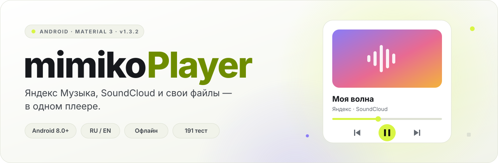
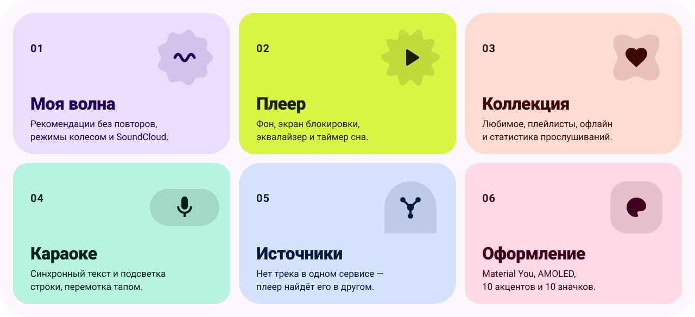
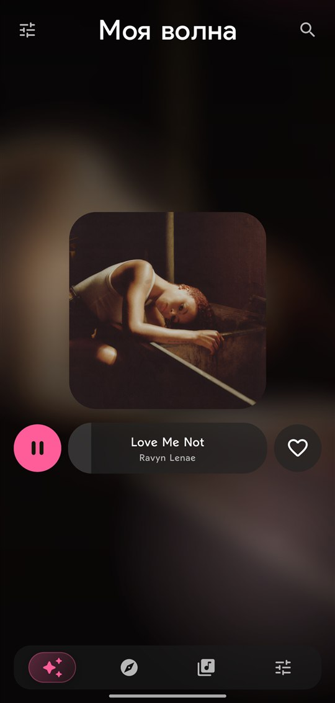
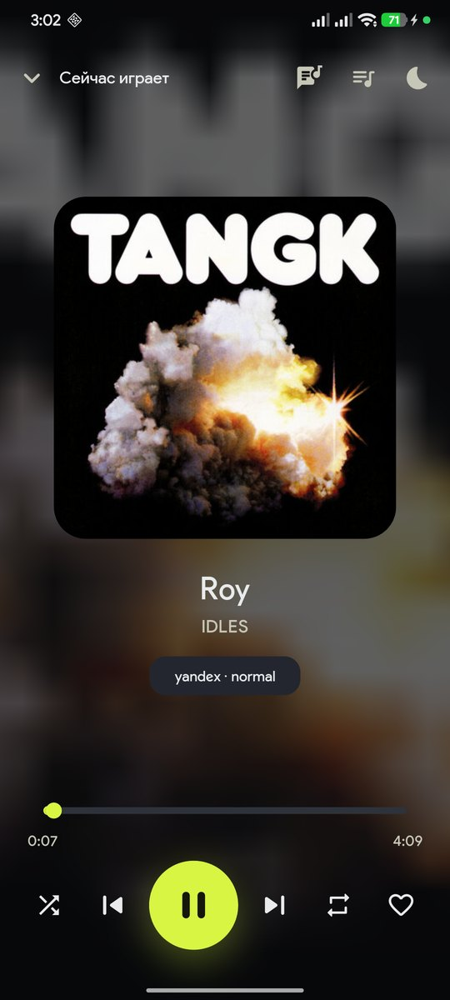
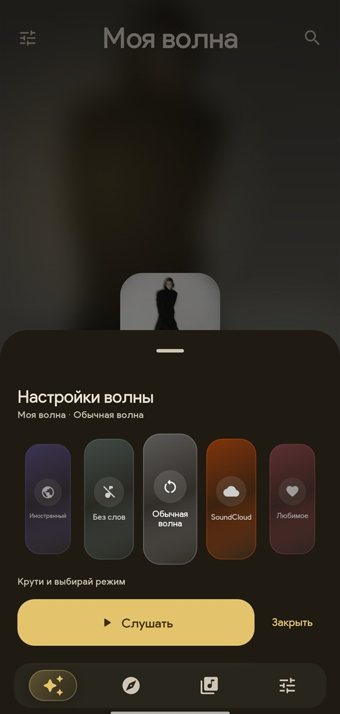
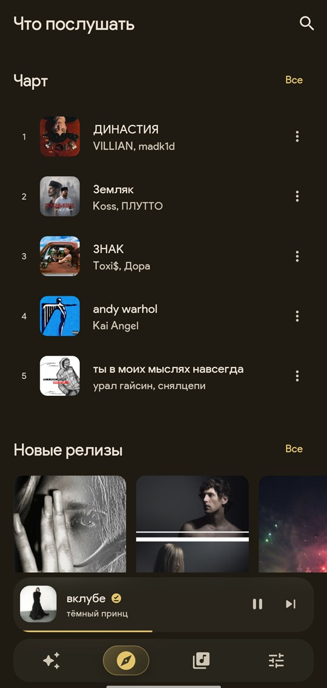
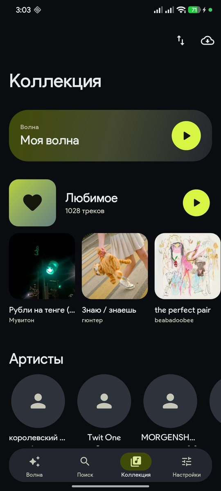
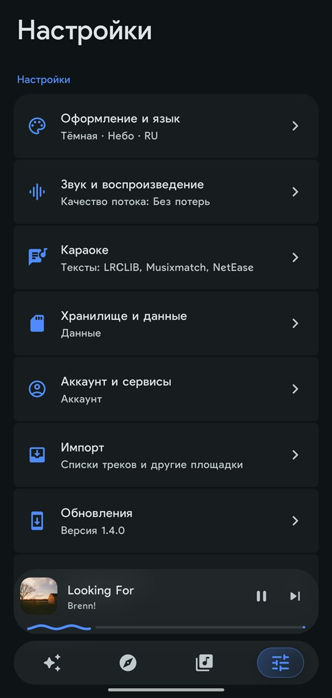
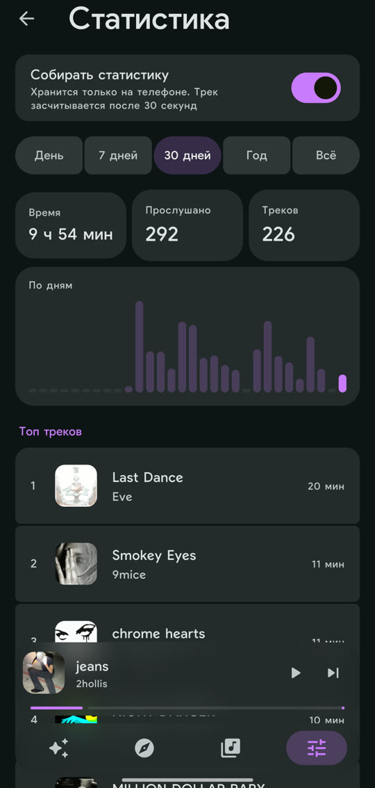
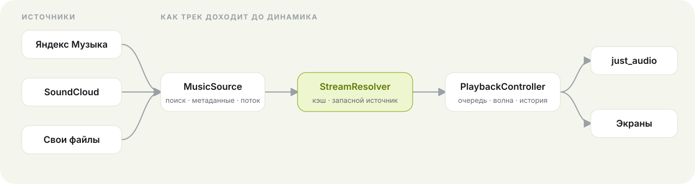

<div align="center">

<picture>
  <source media="(prefers-color-scheme: dark)" srcset="docs/hero-dark.svg">
  
</picture>

<br>

<a href="https://github.com/krinix1337/mimikoPlayer/releases/latest"></a>

<a href="https://flutter.dev"></a>


<h3>Яндекс Музыка, SoundCloud и свои файлы — в одном плеере</h3>

<p>
  <a href="#-возможности"><b>Возможности</b></a> ·
  <a href="#-скриншоты"><b>Скриншоты</b></a> ·
  <a href="#-установка"><b>Установка</b></a> ·
  <a href="#-архитектура"><b>Архитектура</b></a> ·
  <a href="#-сборка"><b>Сборка</b></a>
</p>

</div>

<br>

Один экран «Сейчас играет», одна очередь и одна коллекция — независимо от того, откуда пришёл трек. Если источник не отдаёт песню, плеер сам находит её в другом. Интерфейс собран на токенах **Material 3 Expressive** и показывает только настоящие данные.

> [!NOTE]
> Только Android. Проект не связан с Яндексом и SoundCloud.
## ✨ Возможности

<picture>
  <source media="(prefers-color-scheme: dark)" srcset="docs/features-dark.svg">
  
</picture>

<table>
  <tr>
    <td width="50%" valign="top">

### 🌊 Моя волна
- Персональные рекомендации Яндекса, докачка без повторов
- Режимы колесом: настроение, язык, характер
- **Волна целиком из SoundCloud** на его рекомендациях
- Дизлайк убирает трек — больше он сам не заиграет

</td>
    <td width="50%" valign="top">

### 🎧 Плеер
- Фоновое воспроизведение, уведомление и экран блокировки
- Очередь переживает перезапуск, повтор и перемешивание тоже
- Эквалайзер: 8 пресетов и своя 10-полосная кривая
- Таймер сна — пауза в конце текущего трека

</td>
  </tr>
  <tr>
    <td valign="top">

### 📚 Коллекция
- Любимое, плейлисты, артисты, недавние, файлы
- Свои плейлисты с синхронизацией в Яндекс
- Офлайн: очередь загрузок, докачка, лимит места
- Автозагрузка лайков по Wi-Fi
- Статистика прослушиваний: время, график, топы

</td>
    <td valign="top">

### 🎤 Караоке
- Синхронный текст из LRCLIB, Musixmatch и NetEase, запасной — из Яндекса
- Плавная подсветка строки, перемотка тапом
- Размер текста и приглушение остальных строк

</td>
  </tr>
  <tr>
    <td valign="top">

### 🎨 Оформление
- Светлая, тёмная, Material You, монохром, AMOLED
- 10 акцентов и 10 значков лаунчера
- Адаптивное стекло и размытие обложек
- Русский и английский интерфейс

</td>
    <td valign="top">

### 🛡️ Фильтры и обновления
- Метки 18+, ИИ и «без цензуры»
- Скрытие ИИ-треков по списку Slopless
- Обновления прямо из приложения с проверкой SHA-256

</td>
  </tr>
</table>

## 📱 Скриншоты

<div align="center">
<table>
  <tr>
    <td align="center" width="33%"><br><sub><b>Моя волна</b></sub></td>
    <td align="center" width="33%"><br><sub><b>Сейчас играет</b></sub></td>
    <td align="center" width="33%"><br><sub><b>Режимы волны</b></sub></td>
  </tr>
  <tr>
    <td align="center"><br><sub><b>Что послушать</b></sub></td>
    <td align="center"><br><sub><b>Коллекция</b></sub></td>
    <td align="center"><br><sub><b>Настройки</b></sub></td>
  </tr>
  <tr>
    <td></td>
    <td align="center"><br><sub><b>Статистика</b></sub></td>
    <td></td>
  </tr>
</table>
</div>

## 📦 Установка

1. Скачайте `mimikoPlayer-1.4.2.apk` со страницы **[Releases](https://github.com/krinix1337/mimikoPlayer/releases/latest)**.
2. Откройте файл и разрешите установку из этого источника.
3. Войдите в Яндекс в разделе **Настройки → Аккаунт и сервисы**. SoundCloud и локальные файлы работают без входа.

> [!TIP]
> Дальше обновляться можно из самого приложения: **Настройки → Обновления**. Когда выходит новая версия, у пункта появляется значок.

> [!IMPORTANT]
> На Xiaomi с HyperOS отключите для приложения оптимизацию батареи и разрешите автозапуск — иначе система может останавливать фоновое воспроизведение и загрузки.

## 🧩 Архитектура

Каждый источник — модуль за общим интерфейсом. Если источник не может отдать трек, резолвер идёт к следующему по приоритету, а экраны не знают, откуда пришла музыка.

<picture>
  <source media="(prefers-color-scheme: dark)" srcset="docs/architecture-dark.svg">
  
</picture>

<details>
<summary><b>Структура проекта</b></summary>

```
lib/
├── core/
│   ├── sources/     MusicSource, DTO, типизированные отказы, StreamResolver
│   ├── identity/    нормализация и сведение трека из разных каталогов
│   ├── db/          drift, DAO, аддитивные миграции
│   ├── prefs/       настройки одним снимком
│   └── platform/    мост в Android: частота кадров, значки, теги
├── features/        волна, поиск, коллекция, плеер, каталог, караоке, настройки
├── sources/         yandex, soundcloud, local, lyrics
├── l10n/            строки RU / EN
└── theme/           токены M3: цвет, типографика, формы, движение
```

</details>

| Слой | Технологии |
|---|---|
| UI | Flutter 3.47 · Material 3 Expressive · Riverpod 3 · go_router |
| Звук | just_audio (media3 / ExoPlayer) · audio_service |
| Данные | drift + SQLite |
| Сеть | dio · Yandex Music API · SoundCloud · LRCLIB · Musixmatch · NetEase |
| Фон | WorkManager |

## 🛠️ Сборка

```bash
flutter pub get
dart run build_runner build --delete-conflicting-outputs
flutter gen-l10n
flutter analyze && flutter test
flutter build apk --release
```

`compileSdk = targetSdk = 37`, `minSdk = 24`. Готовый файл — `build/app/outputs/flutter-apk/app-release.apk`.

<details>
<summary><b>Замер плавности на устройстве</b></summary>

<br>

Сборка со счётчиком кадров пишет в logcat, сколько кадров не уложилось в бюджет и чем — сборкой или отрисовкой:

```bash
flutter build apk --profile --dart-define=FRAME_STATS=true
adb logcat -s flutter | grep frames
```

</details>


## ⚖️ Лицензия и данные

MIT — см. [LICENSE](LICENSE).

- «Яндекс Музыка» и SoundCloud — товарные знаки своих правообладателей; проект с ними не связан.
- Это неофициальный клиент: Яндекс Музыка и SoundCloud подключены через их неофициальные API, которые могут измениться или перестать работать в любой момент.
- Для Яндекс Музыки нужен свой аккаунт и подписка Яндекс Плюс; SoundCloud и свои файлы работают без входа. Приложение не обходит ограничения сервисов и не распространяет музыку; скачанные треки — только для личного офлайн-прослушивания.
- Тексты песен приходят из публичных источников по запросу пользователя.
- Список ИИ-исполнителей — [Slopless](https://github.com/alexeyfv/slopless) (GPL-3.0), загружается по сети и не входит в APK.
- Незацензуренные версии — открытая база [FckCensorData](https://github.com/Hazzz895/FckCensorData), загружается по сети.

<div align="center">
<br>
<sub>mimikoPlayer · сделано <a href="https://github.com/krinix1337">krinix1337</a> на Flutter</sub>
</div>
